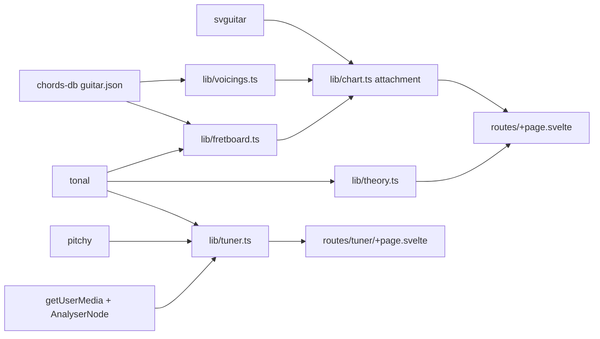

# Guitar Cheatsheet PWA

## Objective

Minimal, installable, offline PWA:
- `/tuner/`: pick audio input (mic or line-in), show nearest note and signed cents.
- `/`: pick root, pick scale/mode, see key info, scale and interval neck maps, diatonic chords, chord types on the root, progressions, chord diagrams.
- No hand-rolled theory, fretboard rendering, fingering data or pitch detection.

## Current state

- `/home/yi/guitar-cheatsheet` is empty and not a git repo. Host `yifuwuqi`.
- The system has Node 24.22.1 and npm 11.19. Local nixpkgs (26.11) has `nodejs_latest` = 26.13.0, the current latest. `statix`, `deadnix` and `nixfmt` are available.
- Latest versions: svelte 5.57.3, @sveltejs/kit 3.1.1, adapter-static 4.0.1, vite 8.3.5, vite-plugin-svelte 7.3.1, svelte-check 4.7.7, sv 1.2.0.
- TypeScript latest is 7.0.2, but Kit 3 and svelte-check require `typescript ^6`. TS 7 also only exposes `unstable/*` APIs, so the plan uses **6.0.3**.
- Kit 3 changes that shape the code:
  - Config goes in `vite.config.ts` via `sveltekit({...})`; there is no `svelte.config.js`.
  - `$lib` is replaced by `#lib/*` subpath imports (`package.json` `imports`), with explicit file extensions.
  - `$service-worker` is removed. Use `$app/manifest` (`immutable`, `assets`, `prerendered`), `$app/env` (`version`) and `$app/service-worker` (`self`).
  - The service worker lives at `src/service-worker/index.ts`, with its own tsconfig extending `$app/tsconfig/service-worker`.
- `@vite-pwa/sveltekit` only supports Kit ^2, so the plan uses Kit's built-in service worker.

## Decisions

- **Runtime deps** (latest, exact-pinned):
  - `tonal` 6.5.1 (4.3k stars, MIT). Handles note spelling, `Key`, `Mode`, `Scale`, `Chord`, `Progression`, `RomanNumeral`, `Interval` and `Midi.freqToMidi`.
  - `svguitar` 2.10.1 (825 stars, MIT, active). Renders both chord diagrams and the full-neck maps (horizontal orientation, 12 frets, labelled/coloured dots, fret markers). Its browser build is self-contained (~325 KB raw).
  - `@tombatossals/chords-db` 0.5.1 (590 stars, MIT). Fingering data from `lib/guitar.json` (238 KB): standard tuning, every suffix we need, keys in chroma order.
  - `pitchy` 4.1.0 (35k downloads/week, MIT, McLeod pitch method). Pitch detection.
  - Rejected: `pitchfinder` (GPL-3), `@moonwave99/fretboard.js` (107 stars, stale since 2022), `vexchords` (stale), `@vite-pwa/sveltekit` (no Kit 3 support).
- **Dev deps**: kit, adapter-static, vite, vite-plugin-svelte, svelte, svelte-check, typescript 6.0.3.
  - No ESLint, Prettier or Vitest.
  - Tests run with built-in `node --test` on Node 26 native type stripping. `erasableSyntaxOnly` keeps the code compatible with it.
- **Rendering**: root `+layout.ts` sets `prerender = true`, `ssr = false`, `trailingSlash = 'always'`.
  - Output is static shells `index.html` and `tuner/index.html`.
  - Client-only is required anyway: svguitar measures DOM text, and the tuner needs the mic and AudioContext.
- **Strictness**: one shared `tsconfig.strict.json`, extended by both the root and service-worker tsconfigs (array `extends`).
  - Flags: `strict`, `exactOptionalPropertyTypes`, `noUncheckedIndexedAccess`, `noPropertyAccessFromIndexSignature`, `noImplicitOverride`, `noImplicitReturns`, `noFallthroughCasesInSwitch`, `noUnusedLocals`, `noUnusedParameters`.
  - Also `allowUnreachableCode: false`, `allowUnusedLabels: false`, `noUncheckedSideEffectImports`, `erasableSyntaxOnly`, `allowImportingTsExtensions`.
  - `svelte-check --fail-on-warnings`.
- **Root spelling**: 12 root buttons with no sharp/flat toggle. Black-key roots are spelled sharp or flat, whichever gives fewer accidentals for the selected scale (computed with Tonal). Examples: Db major, C# minor.
- **Single sources of truth**:
  - `SCALES`, `CHORD_TYPES` (Tonal type mapped to chords-db suffix) and `PROGRESSIONS` (Tonal Roman numerals) tables live in `theory.ts`.
  - Tuning comes from chords-db `tunings.standard`.
  - One svguitar attachment draws every chart.
- **Tuner**:
  - Note names use sharps; A4 = 440 (Tonal default). Readings are gated on pitchy's clarity value, with no other smoothing.
  - Inputs come from `enumerateDevices()` (`audioinput`). Constraints disable `echoCancellation`, `noiseSuppression` and `autoGainControl`.
- **Theme**: CSS `color-scheme: light dark` with `light-dark()`. svguitar colours use `currentColor`; if that fails, pass resolved CSS custom properties.
- **Icons**: hand-written `static/icon.svg`. PNGs are rasterized once via `nix shell nixpkgs#librsvg` (a tool, not a project dep).

## Phases

1. **Toolchain and scaffold**
   - `flake.nix`: input `github:NixOS/nixpkgs/nixos-unstable`. Outputs `devShells = lib.genAttrs lib.systems.flakeExposed (system: { default = pkgs.mkShellNoCC { packages = [ pkgs.nodejs_latest ]; }; })`.
   - Scaffold: `nix develop -c npx sv@1.2.0 create --template minimal --types ts --no-add-ons --install npm --no-dir-check .`
   - Swap in `@sveltejs/adapter-static`, add the runtime deps, pin TS 6.0.3, and set `.npmrc` `save-exact=true`.
   - `tsconfig.strict.json` plus `tsconfig.json` `"extends": ["$app/tsconfig", "./tsconfig.strict.json"]`, excluding `src/service-worker`.
   - Scripts: `check` = sv's check with `--fail-on-warnings`, plus `tsc -p src/service-worker`. `test` = `node --test "src/**/*.test.ts"`.
2. **PWA shell**
   - `src/routes/+layout.ts`: page options as above.
   - `src/routes/+layout.svelte`: two-link nav and CSS vars.
   - `src/app.html`: manifest link, icons, `theme-color`.
   - `static/manifest.webmanifest` and icons: `icon.svg`; 192 and 512 PNGs; 512 maskable; 180 apple-touch.
   - `src/service-worker/index.ts` and its `tsconfig.json`:
     - Precache `immutable`, `assets` and `prerendered` into `cache-${version}`.
     - Delete old caches on activate.
     - Precached files are cache-first. Other same-origin GETs try the network, then fall back to cache.
3. **Theory adapters**: `src/lib/theory.ts` plus test.
   - `SCALES`: major, minor, harmonic minor, melodic minor, major pentatonic, minor pentatonic, minor blues. Modes come from `Mode.names()`.
   - `spell(chroma, scale)` and scale notes/formula.
   - `keyInfo`: key signature and relative keys from `Key.majorKey`/`Key.minorKey`, the parallel key, and circle-of-fifths neighbours via `Note.transposeFifths(t, ±1)`.
   - `diatonic`: triads and 7ths from `Mode.triads`/`Mode.seventhChords`, or `Key.minorKey(t).harmonic`/`.melodic` for the minor variants. Roman numerals come from scale intervals via `RomanNumeral`.
   - `CHORD_TYPES`: the 15 types shown (maj, m, 7, maj7, m7, m7b5, dim, dim7, aug, sus2, sus4, 6, m6, 9, add9), plus `mMaj7` and `maj7#5` needed for minor harmonisation.
   - `PROGRESSIONS`, resolved via `Progression.fromRomanNumerals`:
     - Major: I-IV-V, I-V-vi-IV, I-vi-IV-V, ii-V-I, 12-bar blues.
     - Minor: i-iv-v, i-VI-III-VII, i-VII-VI-V, iiø-V-i.
   - Tests:
     - Every `CHORD_TYPES` entry exists in both Tonal and chords-db `suffixes`.
     - Spelling cases (Db major, C# minor, F# major).
     - Progression samples resolve to the expected chords.
     - Exhaustive: for all 12 roots and every heptatonic scale/mode, each diatonic chord maps to a `CHORD_TYPES` entry.
4. **Charts**
   - `src/lib/chart.ts`: Svelte `{@attach}` factory `chart(chord, config)`. It runs `new SVGuitarChord(node).chord(chord).configure(config).draw()` and clears the node on cleanup.
   - `src/lib/fretboard.ts`: `neck(notes, label)` turns notes into svguitar fingers over frets 0-12 of `tunings.standard`, with the root coloured.
     - `NECK` config: horizontal, 12 frets, markers at 3/5/7/9/12, `noPosition`.
     - Open-string notes use svguitar's open markers; the tuning labels name them.
   - `src/lib/voicings.ts`: maps chords-db positions to svguitar `{ fingers, barres, position }`. Fret `-1` becomes `'x'`, `0` stays open, and barres become `fromString`/`toString`.
   - Tests:
     - Known shapes map correctly (open C, F barre).
     - Every position for every key and shown suffix maps without error.
     - Each voicing's midi chromas are a subset of the chord's chromas.
5. **Cheatsheet**: `src/routes/+page.svelte`.
   - Controls: a root radio group (12 roots) and a scale/mode `<select>` with optgroups.
   - Key section: signature, relative/parallel keys, IV/V neighbours.
   - Scale section: notes, formula, neck map.
   - Intervals section: chromatic neck map labelled 1 through 7, with b/# degrees.
   - Diatonic chords section: triads and 7ths with numerals and the first voicing. Hidden for pentatonic and blues.
   - Chords on the root: 15 types, each showing its first voicing, with other voicings in `
`.
   - Progressions: major and minor, resolved chord names.
6. **Tuner**
   - `src/lib/tuner.ts`:
     - `detect(buf, sampleRate)`: pitchy, then the clarity gate, then `Midi.freqToMidi`. Returns `{ note, cents, hz }`.
     - `listen(deviceId, onReading)`: getUserMedia with processing off, AnalyserNode with `fftSize` 4096, a requestAnimationFrame loop. Returns `stop()`.
   - `src/routes/tuner/+page.svelte`: input select, Start/Stop button, note, signed cents, a CSS bar, and an in-tune state at |cents| <= 5.
   - Tests: synthetic sine and sawtooth at E2, A2 and A4, and at ±20 cents, give the expected note and cents within ±2.
7. **Verification** (inside `nix develop`)
   - `npm run check`, `npm test`, `npm run build`. Report chunk sizes.
   - `statix check flake.nix`, `deadnix flake.nix`, `nixfmt --check flake.nix`, `nix flake check --no-build`.
   - Manual run via `npm run preview`:
     - The install prompt appears, and the Application tab shows the manifest and an active service worker.
     - `/` and `/tuner/` reload while offline.
     - The tuner works with the mic on localhost.

## Rollout order

- Phase 1, then 2, 3, 4, 5. Phase 6 only depends on 1 and 2, so it can follow 2 directly.
- After each phase, run `check` and `test`; run the full Phase 7 at the end.
- The project is not a git repo, so `git diff` auditing is not possible yet; the agent reports the file list instead. After `git init`, `flake.nix`/`flake.lock` must be tracked (`git add`, done by the user) for the flake to see them.

## Open questions

- Hosting target? The default `build/` works on any static host; a GitHub Pages project site needs `paths.base`.
- Persist the last root/scale across launches (localStorage)? Default: no.
- Left-handed mirror (svguitar supports it)? Default: no.
- Move to TS 7 once svelte-check supports it.
